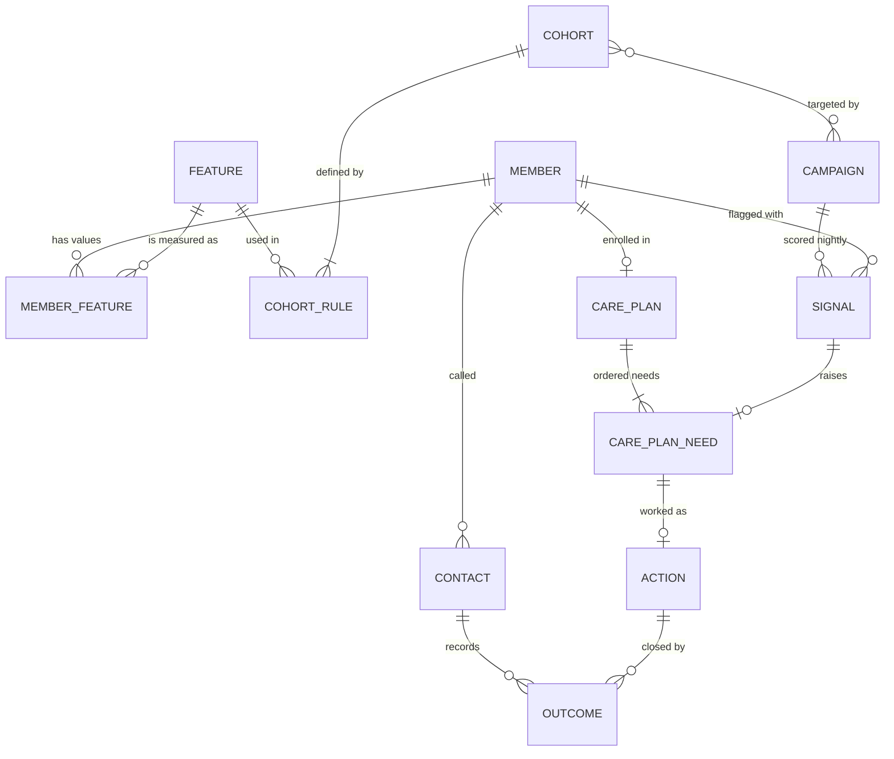

# Chronic Care Loop · data model

Ten entities, one loop. Every screen reads or writes only these.

```
 Feature ──defines──▶ Cohort ──feeds──▶ Campaign ──scores──▶ Signal ──builds──▶ CarePlan ──has──▶ CarePlanNeed ◀──1:1──▶ Action
    ▲                                                                                                                │
    └──────────────── nightly run ◀── Outcome ◀── Contact (call + consent) ◀───────────────────────────────────────────┘
```



## Entities

| # | Entity | Key fields | Written by | Read by |
|---|--------|-----------|------------|---------|
| 1 | **Member** | `member_id`, `mask`, age, sex, plan, language, conditions[], `consent_status` | Claims / EMR load | all screens |
| 2 | **Feature** | `feature_key`, label, `source` (`catalogue` \| `graph`), type (`bool` \| `num` \| `code`), unit, nGQL | Studio · Cohorts (Describe → *Create feature*) | Cohort rules, Rules search |
| 3 | **MemberFeature** | `member_id`, `feature_key`, value, `as_of` | Nightly refresh (materialises graph features) | Cohort estimate, care intelligence |
| 4 | **Cohort** | `cohort_id`, `version`, base, logic (`all` \| `any`), rules[] = (`feature_key`, op, value, exclude?), refresh | Studio · Cohorts | Campaigns |
| 5 | **Campaign** | `campaign_id`, `cohort_ids[]`, exclude[], trigger mode, channels, nurses × calls, holdout %, start, weeks, priority, status | Studio · Campaigns (hand-off) | Care intelligence |
| 6 | **Signal** | `member_id`, `code` (e.g. `REPEAT_ER`), class (`safety` → `goal`), severity, evidence, `run_at`; plus risk score R / tier | Care intelligence (03:00 run) | Care plan, Nudge queue |
| 7 | **CarePlan** | `careplan_id`, `member_id`, pathway (DM, HTN, DM + HTN), tier, cadence | Care intelligence, after consent | Portal · Care plans |
| 8 | **CarePlanNeed** | `need_key` (= signal code), class, slot (`CURRENT` \| `NEXT` \| `FUTURE`), owner role, *done when*, due, status | Care intelligence; status from Action/Outcome | Portal · Care plans |
| 9 | **Action** | `action_id`, `member_id`, `need_key` (nullable), kind (`care_plan` \| `agreed` \| `callback` \| `retry` \| `check_in`), due, assignee, status | Portal (call outcome, care plan, Actions page) | Portal · Actions, Care plans |
| 10 | **Contact → Outcome** | Contact: `member_id`, `campaign_id`, reached, consent (granted / declined), response, notes. Outcome: `member_id`, `need_key` / `action_id`, result (`done` \| `declined` \| `not_reached`), `at` | Portal · Nudge queue | Nightly run (write-back) |

## Three rules that keep it lean

1. **A feature is reused before it is created.** Describe checks the catalogue first (the same search as the Rules box). Only parts the catalogue cannot express go to the knowledge graph. They become a new `Feature` with `source = graph`.
2. **One care-plan need = one action.** Each `CURRENT` `CarePlanNeed` has exactly one `Action` with the same `need_key`. Closing either one closes the other: a tick, a booking, a refill or the care plan's *Done*. *Declined* holds the need for 90 days. *Not reached* keeps it open and adds a retry.
3. **Outcomes are the only way back.** The portal never edits signals or scores. It writes `Outcome` events. The next nightly run re-scores from them.

## How the artefacts exchange data (prototype)

When the portal runs inside the Studio (screen 3), the two talk over `postMessage`:

| Message | Direction | Payload |
|---------|-----------|---------|
| `ccl:ready` | portal → studio | none |
| `ccl:sync` | studio → portal | `queued` (member masks on the call list), `focus` (member to open), `campaign` |
| `ccl:writeback` | portal → studio | `id` (mask), name, response, actions, open tasks |

All data in the prototypes is synthetic.
