# Chronic Care Loop · developer guide for the GCEO demo build

For the three developers. It assumes you have never used GitHub, that you build with an AI coding tool most of the day, and that you have one SingleStore server between you. Read it once, top to bottom. It takes 25 minutes.

## 1. Getting the code (no GitHub skills needed)

The code lives in a private GitHub repository called `chronic-care-loop`. Private means the link shows a 404 page until the owner adds you. There are three ways to get it, easiest first.

**Way 1: the zip.** The lead posts `CCL-2-Day-Build.zip` in the Teams channel. Download it, unzip it somewhere simple like `C:\ccl` or `~/ccl`. That folder is everything you need. If you change files, zip the folder back up and post it in the channel with your name and the time. Good enough for two days.

**Way 2: GitHub Desktop (recommended if you want to share changes properly).**
1. Ask the lead to add you. The lead opens the repository on github.com, clicks **Settings → Collaborators → Add people**, types your GitHub username or email, clicks Add. You get an email; click **Accept invitation**. If you have no GitHub account, make one first at github.com (free, two minutes).
2. Install GitHub Desktop from desktop.github.com and sign in with the same account.
3. In GitHub Desktop: **File → Clone repository**, pick `chronic-care-loop`, choose a folder, click Clone. The folder appears on your disk. Work only inside `two-day-build/`.
4. When you have changed something and it works: in GitHub Desktop, tick the changed files, write one line in the Summary box (what you changed and why), click **Commit to main**, then click **Push origin**. Everyone else clicks **Fetch origin** and gets it. If it says there is a conflict, stop and ask in the channel; do not click through it.

**Way 3: the command line**, if you already have `git`:

```bash
git clone https://github.com/mehzahkhanhabib-hash/chronic-care-loop.git
cd chronic-care-loop/two-day-build
```

and later `git add -A && git commit -m "what you did" && git push`.

**Working with your AI coding tool.** Open the `two-day-build` folder as the project. Point the tool at `README.md`, `PLAN.md` and this file first. Ask it to read `sql/` before touching anything. Three rules it must follow, and you must check: it never changes a file outside your layer without telling you; it never puts a threshold or a rule in app code (rules live in `rules/*.csv`); it never writes to a table directly from a screen (screens call the API).

**Don't rename files.** The SQL files are numbered and the other developers' tools expect those names.

## 2. One member through every screen

The demo member is **Majid Al Hammadi**, the pseudonym the apps give to `m26` in the 24-row sample and `s26` in the 248-member snapshot. Same person. Everything below is a real screenshot of today's apps running on the prototype backend with his real (masked) data. On Day 2 the same screens read from SingleStore.

### Screen 1 of the Studio: the cohort (population health team)

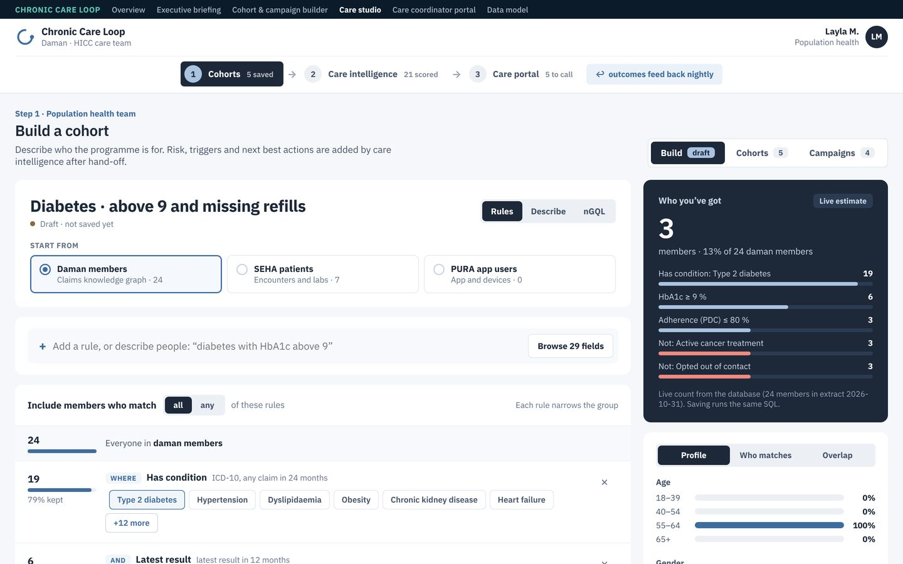

The population-health lead describes who the programme is for: type 2 diabetes, HbA1c at or above 9, adherence at or below 80 percent, not in cancer treatment, not opted out. The right panel counts live from the database as each rule is added. Majid matches: he has type 2 diabetes, HbA1c 11, DPP-4 adherence 35 percent. Saving the cohort and handing it off as a campaign is what puts him in scope for the rules.

**Behind it:** `POST /cohorts/estimate` compiles the rules to one `COUNT(*)` on `member`. Hand-off writes `campaign` and `campaign_member` (with a stable 10 percent holdout who are never contacted) and presses the rules run. Owner: Dev C.

### Screen 2 of the Studio: care intelligence (clinical lead)

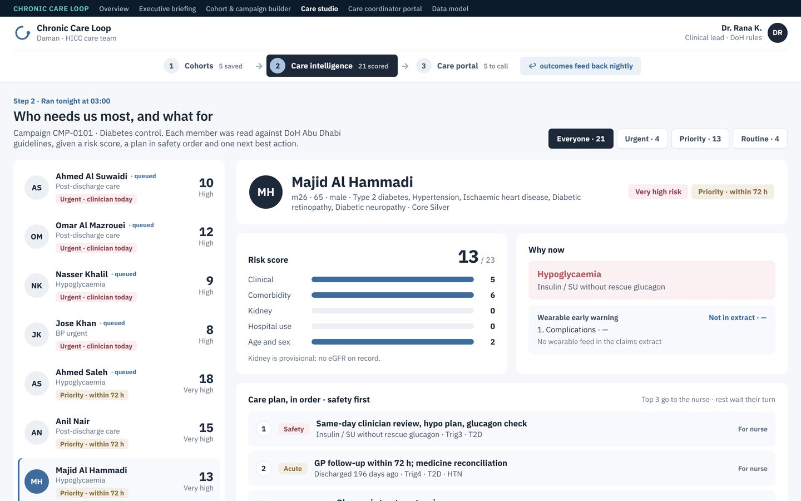

Every campaign member has been read against the rules. Majid: risk 13 of 23 (clinical 5, comorbidity 6, age and sex 2, kidney provisional because there is no eGFR on record), tier 4 Very high, priority within 72 hours. "Why now" is the top rule that fired: hypoglycaemia, insulin or sulfonylurea without rescue glucagon. Below it, his care plan in rulebook order: 1 safety, same-day clinician review, hypo plan, glucagon check (Trig3); 2 acute, GP follow-up within 72 hours (Trig4, discharged 196 days ago); 3 uncontrolled, glycaemic treatment review (Trig1). "Top 3 go to the nurse, the rest wait their turn."

**Behind it:** `member_signal` (which rules fired, with evidence), `member.r_total / tier / alert / contact_priority`, `care_plan_need` with its slot. Served by `GET /members/{id}` and `GET /members/{id}/rulebook`. Owner: Dev A for the rules and scores, Dev B for the needs.

### Screen 3 of the Studio: the care portal, embedded

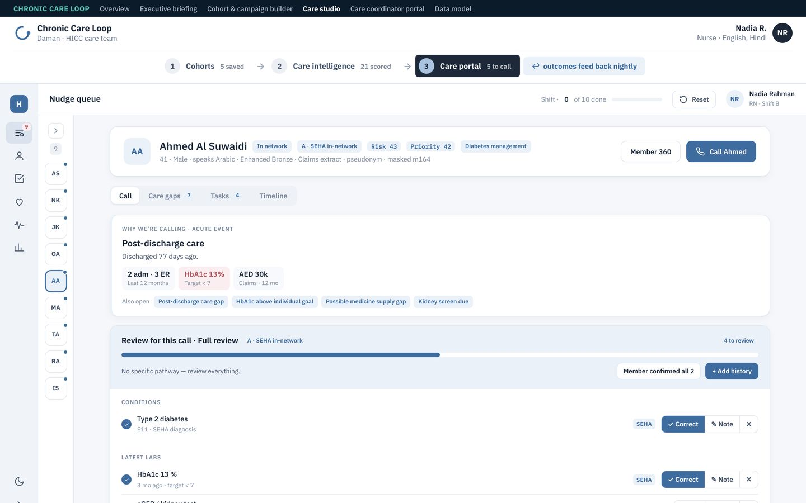

The same portal the nurses use, shown inside the Studio so the GCEO sees the hand-off end to end without changing windows. The nurse's queue on the left is the worklist. Owner: Dev C for the queue, Dev B for everything inside a member.

### The Care Coordinator Portal: the nurse's day

**Step 1 · The nudge queue.** Nurse Nadia opens her shift. Five members today, in order. Majid is second: hypoglycaemia, risk 57, priority 59, consent needed, follow-up overdue today. The right side says why we are calling (the safety rule, with his numbers: one admission and one ER visit in 12 months, HbA1c 11 percent, adherence 35 percent, 18k in claims) and what else is open. Everything below consent is locked.

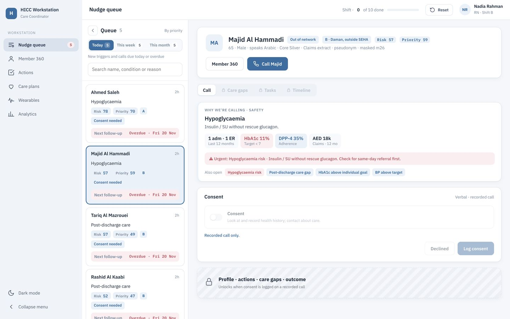

Nurse rule: decision tree step A (assigned to me) and B (urgent?). The red banner is step B: check for same-day referral before anything else. Behind it: `worklist` row for Majid, led by his P1 call action; `GET /worklist?nurse=`. Owner: Dev C.

**Step 2 · Call and consent.** She presses Call. The call connects (00:05, recording). Only now can the consent toggle be used, and only on a recorded call. She reads the consent line, toggles it, logs it.

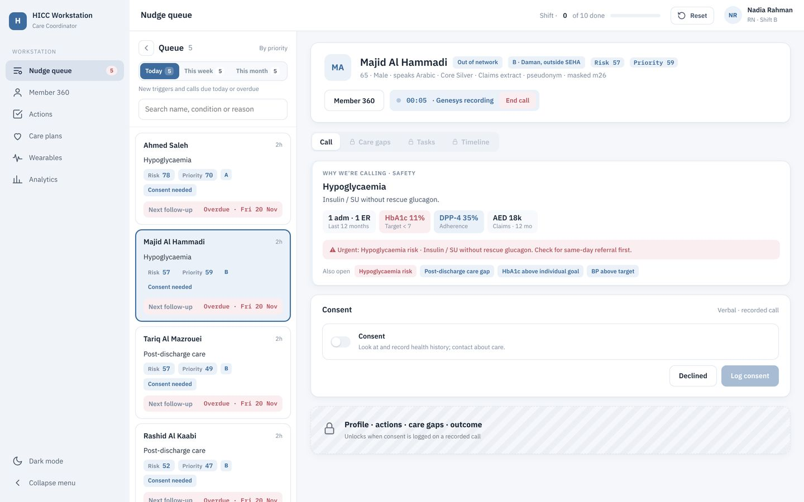

Nurse rule: step C (contact) and D (consent gate). No clinical detail is shown before consent. Behind it: `member.consent` = granted, written through `POST /actions/{id}/outcome` with `consent: granted` and `reached: 1`. Owner: Dev B.

**Step 3 · Review.** Consent unlocks the review: only what this call needs, eight lines. Five conditions from claims (type 2 diabetes, hypertension, ischaemic heart disease, retinopathy, neuropathy) and three medicines with their coverage (DPP-4 at 35 percent, metformin 63, SGLT2 75). For each line the nurse marks Correct, adds a Note, or removes it. "Member confirmed all 8" does it in one click.

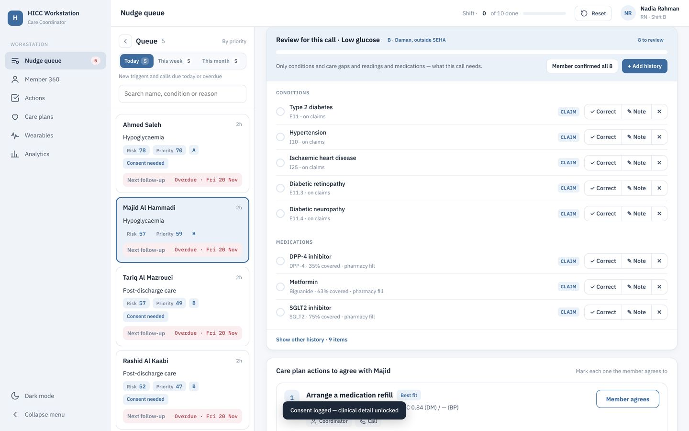

Nurse rule: step E (new problem?) and the G8 guardrail: when a value the rules need is missing, ask the member once and record it. The review is the "assess" moment of the call. Behind it, for the demo: the notes are saved with the outcome. A structured review table is a post-demo item.

**Step 4 · Actions to agree.** The three CURRENT care-plan actions appear as cards with the ask script, the owner role, the channel, and the booking widget. Nadia marks "Arrange a medication refill" agreed (refill of the DPP-4, home delivery), and "Book a glycaemic treatment review" agreed, with the member's preferred date. The BP recheck stays not agreed. The guardrail text under the refill card ("Do not label non-adherence; an absent dispensing record alone does not prove missed doses") is the rulebook speaking.

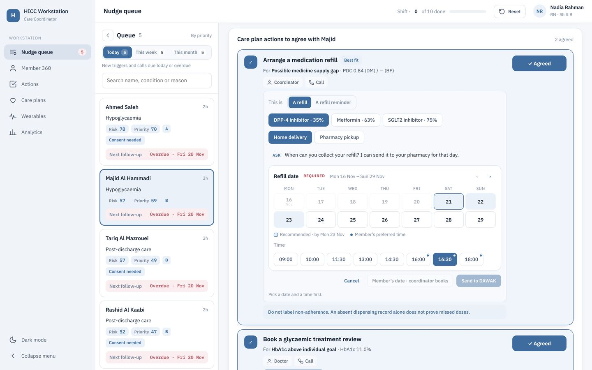

Nurse rule: step I (at most three needs per call) and the write-back rules: agreed, done, declined, not reached. Behind it: each button is one call to `POST /actions/{id}/outcome` with `result` = agreed / done / declined / not_reached. The follow-up table `rule_followup` decides what gets created. Owner: Dev B.

**Step 5 · Outcome.** End call. The outcome is set automatically from what was agreed (Actions agreed · 2). Below it, the next steps: the two agreed actions as coordinator tasks assigned to Nadia, the BP recheck still open as a care-plan action, and a follow-up call for the post-discharge gap in about 7 days, the date taken from the guideline timing.

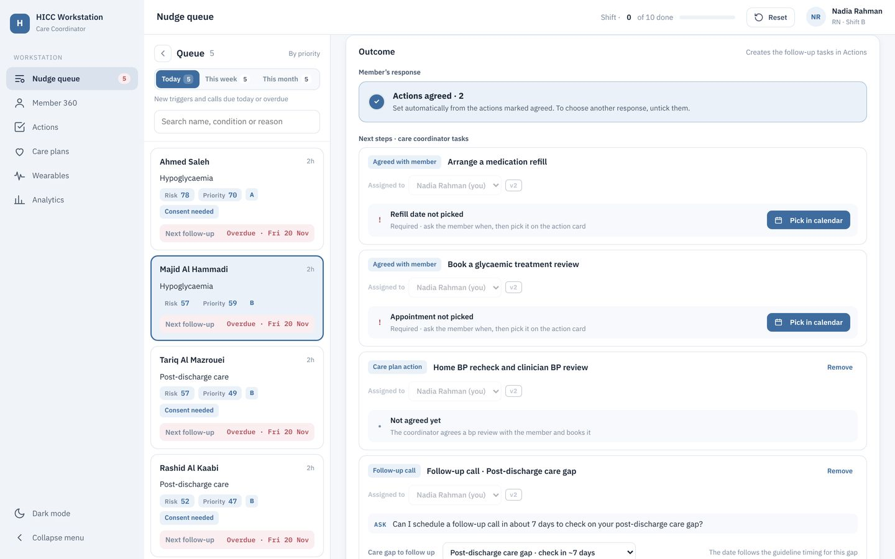

Nurse rule: step J (document) and the cadence rule for tier 4. Behind it: `outcome` rows, closed actions, new `action` rows of kind follow_up with `parent_action_id` pointing at the action they came from. Owner: Dev B.

**Step 6 · Member 360 after the call.** The journey bar now reads Flagged → Contacted (reached) → Consent (verbal, recorded call) → Reviewed → Actions (2 agreed) → Outcome (open) → Follow-up. The timeline shows the three care-plan items with their due dates and the call that just ended.

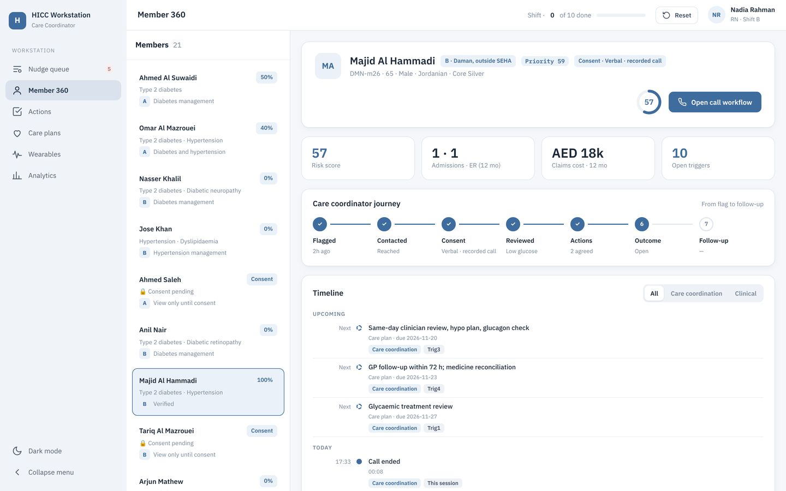

Behind it: `GET /members/{id}` (`v_member_summary`), `GET /members/{id}/actions` (`v_action_chain`). Owner: Dev B.

**Step 7 · The care plan page.** Risk 13 of 23 with the five components, the decision path A to J with each step's answer (urgent: no; alert: AMBER; three needs), and the plan in three columns: CURRENT 3, NEXT 3, FUTURE 4, in rulebook order safety → acute → uncontrolled → barrier → gap → goal. Each CURRENT card has Done, Declined, Not reached. A NEXT card says "becomes an action when it reaches Current".

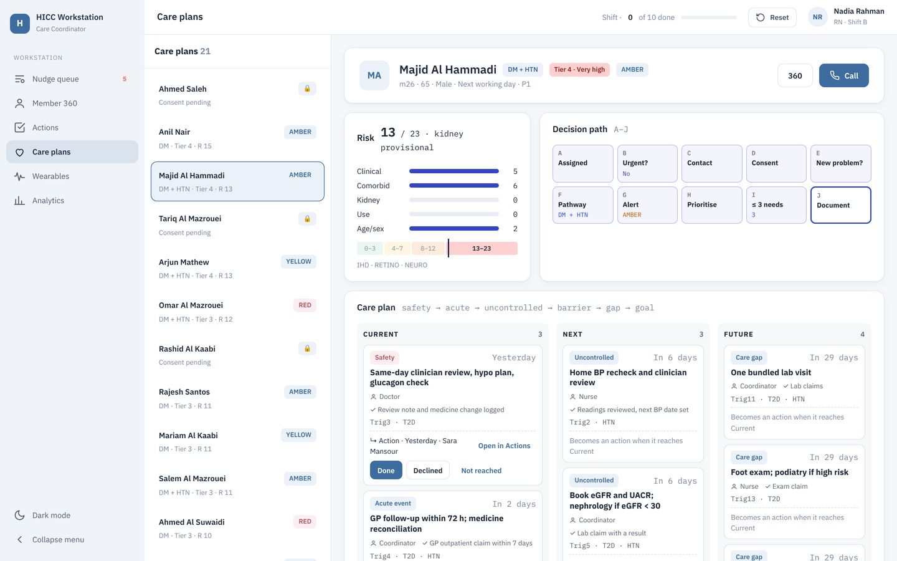

Nurse rule: G7, exactly one open action per CURRENT need; G4, declined is held 90 days; G9, existing needs keep their status on a re-run. Behind it: `v_care_plan`, `GET /members/{id}/care-plan`. Owner: Dev B.

**Step 8 · The actions page.** Every task from every call, as a calendar and a list: backlog, today, upcoming. This is where a coordinator works through the day after the calls.

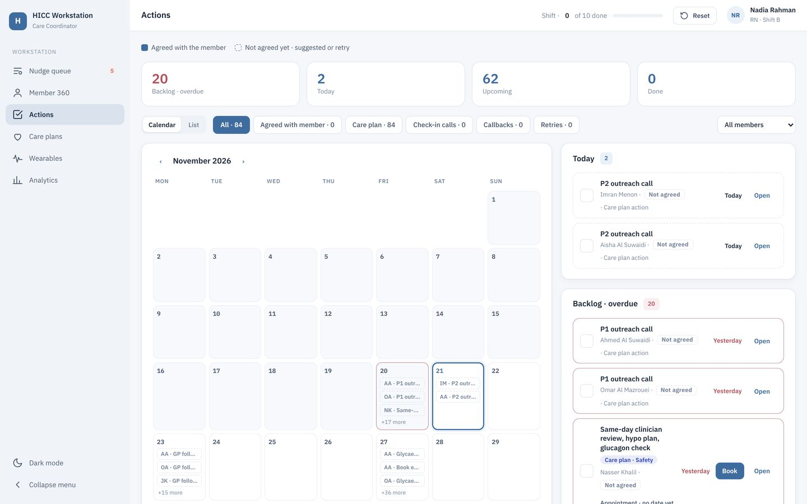

Behind it: `action` filtered by assignee and due date. Owner: Dev B for the data, Dev C for the queue ordering.

**Then: press Run rules.** The worklist is rebuilt. Majid is back on Omar's list (he keeps the nurse who already holds his actions), led by the cadence check-in due 27 Nov. The need marked done reads Awaiting claims; the declined one is on hold to 18 Feb. That is beat 5 of the demo, and the reason the backend has to be real.

## 3. Review → assess → actions, and how each maps to a table

| What the nurse does | Nurse rule (rulebook) | What the system does | Table / endpoint |
|---|---|---|---|
| Opens the queue | §4 worklist order: RED or safety first, then tier, then campaign priority, then due; language match; capacity | shows her list for today, one row per member, led by the most urgent open action | `worklist` · `GET /worklist?nurse=` |
| Reads "why we're calling" | §3: the top fired rule by class order | shows the rule, its evidence, the member's numbers | `member_signal`, `care_plan_need` (slot CURRENT, lowest class order) |
| Calls, gets through | write-back: reached; G3: no new outreach for 14 days after a reached call | closes the call action; creates a cadence check-in by tier | `outcome`, `action` (follow_up) · `POST /actions/{id}/outcome` result=reached |
| Logs consent | consent gate | member.consent = granted; everything unlocks | `member.consent` (same call, `consent: granted`) |
| Reviews 8 lines, marks correct or notes | E new problem?; G8 ask once | notes stored with the outcome | `outcome.notes` |
| Marks an action agreed | write-back: agreed → Scheduled | need gap_state = Scheduled; follow-up "check it happened" on the agreed date | `care_plan_need.gap_state`, `action` |
| Marks an action done | write-back: done → Reported, not Closed | follow-up "verify in claims" in 14 days; next need moves into CURRENT; claims close it later | `care_plan_need` (Reported), `action` (care_plan for the promoted need) |
| Marks declined | G4: 90-day hold, then re-offer | need declined, hold_until +90 days; re-offer follow-up; next need promoted | `care_plan_need.hold_until`, `action` |
| Not reached | 3 attempts; P1 escalates | retry action; after the third, escalation to the clinical lead | `action` (retry / escalation) |
| Ends the call | J document; cadence by tier | outcome saved; next touchpoint computed | `outcome`, `v_member_summary.next_touchpoint` |
| Next run | G7 one action per CURRENT need; G9 keep statuses | rebuilds slots, actions, contacts and the worklist; a member stays with their nurse | `04_nightly.sql` · `POST /runs/rules` |

## 4. Technical implementation

```
                ┌──────────────── SingleStore (one database: ccl) ────────────────┐
                │  REFERENCE: rule_* · nurse · nurse_language · campaign · run_config│
                │  ROWSTORE (sharded by member_id): stg_extract · member ·            │
                │     campaign_member · member_signal · care_plan_need · action ·     │
                │     outcome · worklist                                              │
                │  VIEWS: v_worklist · v_care_plan · v_rulebook_member ·              │
                │     v_member_summary · v_action_chain · v_rulebook_programme · v_kpis│
                └────────────────────────────▲────────────────────────────────────────┘
                                             │ pymysql, port 3306
                ┌────────────────────────────┴────────────────────────────────────────┐
                │  api/server.py  (Python, ~250 lines, port 8080)                     │
                │  15 endpoints: each one is a SQL file or SELECT * FROM a view        │
                │  also serves apps/*.html as static files on the same port           │
                └────────────────────────────▲────────────────────────────────────────┘
                                             │ http, JSON
          Cohort & Campaign Builder   ·   Chronic Care Studio   ·   Care Coordinator Portal
                (one HTML file)              (one HTML file)            (one HTML file)
```

- **Everything that decides anything is SQL**, in seven numbered files. The rules are rows. The nightly file is the engine; it is pressed as a button in the demo.
- **The API is deliberately thin.** It has no business logic. If it is ever rewritten in Node or Java, the SQL does not change.
- **The apps are three static HTML files.** They need no build step. They call the API with plain fetch and fall back to their built-in sample data if the API is down.

**Where does it run?** You have one SingleStore server and no app server yet. Three options, pick the first that is available:

| Option | What | Good for |
|---|---|---|
| A. A small VM or container next to SingleStore (2 CPU, 2 GB) | run `python3 server.py --port 8080`; it serves the API and the three HTML files; everyone opens `http://<vm>:8080/` | the whole team sharing one running system; the demo |
| B. The presenter's laptop | same command; SingleStore reached over the network; apps on `http://localhost:8080/` | the demo if no VM can be had by Day 2; rehearse on the same laptop |
| C. Each developer's laptop | same command, each pointed at their own database copy (see §6) | Day 1 development |

Configuration is five environment variables: `S2_HOST`, `S2_PORT`, `S2_USER`, `S2_PASSWORD`, `S2_DB`. The apps find the API on the same origin they were served from, so nothing in the HTML has to change between options.

Put the extract on the SingleStore server or the VM, not on laptops, and never in the zip you post in Teams.

## 5. Tables per developer, what each bakes in, and why

| Developer | Tables they create and own | Rules they bake in | Why those rules live there |
|---|---|---|---|
| **A · Rule layer** | `rule_trigger` (14 rules), `rule_priority`, `rule_tier`, `rule_cadence`, `rule_followup`, `run_config`; writes `member_signal`; updates `member.r_total`, `tier`, `alert`, `contact_priority` | each rule's condition as SQL generated from `rules/rule_condition.csv`; `use_variant` (extract flag or rulebook threshold) per rule; `cannot_tell` when a needed value is missing; score R = C + M + K + U + A; tier bands; alert colour; P1 to P4 from alert and the post-discharge rule | because a rule must be one row a clinician can read and sign off, with its evidence; if it lives in app code, nobody can audit it and every frontend would have its own copy |
| **B · Member 360** | `stg_extract` (341 text columns), `member` (80 typed columns), `care_plan_need`, `action`, `outcome` | G0 cleaning (999 and 1/1 placeholders to NULL, dates parsed, money text to numbers); G7 one open care-plan action per CURRENT need; the write-back table (reached, agreed, done, declined, not reached, each with what it creates); G4 90-day hold; "a gap closes only in claims"; `parent_action_id` on every follow-up | because the member's state has to be the same whichever screen looks at it; the nurse's click must produce the next action deterministically, and the audit trail from action to outcome to follow-up is the proof that the loop closed |
| **C · Worklist orchestration** | `campaign`, `campaign_member`, `nurse`, `nurse_language`, `worklist` | holdout 10 percent by CRC32, never contacted; one contact per member per day; no new outreach within 14 days of a reached call; queue order; language match then round-robin; daily capacity, rest queued; a member stays with the nurse who holds their actions; escalations to the lead only | because fairness and safety of outreach is a population rule, not a per-member one: it needs all members and all nurses at once, so it belongs in the step that sees the whole table |

Each developer also owns the views and endpoints listed in `DELIVERABLES.md`, and the screen those feed.

## 6. Working together on one SingleStore

- **One shared database, `ccl`, is the integration point.** It is rebuilt from the SQL files, never edited by hand. Only the lead (or Dev B on Day 1) runs the rebuild.
- **Each developer gets a private copy**: `ccl_a`, `ccl_b`, `ccl_c`. Create it with the same seven files; break it as much as you like. `S2_DB=ccl_b python3 server.py` points your API at yours.
- **The files are the truth, not the database.** A change is done when it is in a file in the folder and the shared `ccl` can be rebuilt from scratch with it. The rebuild is: drop the database, run 01, 02, 02b, 06, load, press Run rules, run `tests/test_kit.py`. Under a minute.
- **Rebuild the shared `ccl` at 13:00 and 17:00**, right before the standup, from whatever is in the folder. If the tests fail, the last change goes back to its owner.
- **Change only your layer's files.** If you need something from another layer (a column, a view field), ask in the channel; the owner adds it, usually in minutes.
- **Reference tables are small; member tables are sharded by member_id.** Keep every join on `member_id`, and your SQL will be fast on SingleStore without tuning.
- **Credentials**: one SingleStore user per developer, read-write on their own copy and on `ccl`. Never paste a password in Teams or in a file in the folder.

## 7. The steps, in order

Day 0 (tonight): lead posts the zip and the Teams message; developers install the MySQL client and pymysql, confirm SingleStore login.

Day 1, 09:45 to 10:30, together: shared `ccl` built, snapshot loaded, first rules run, KPI row posted. Expected: 248 members, 1,442 rules fired, 218 care plans, 632 CURRENT needs, 0 without an action, 75 on today's list, 143 queued.

Day 1, rest of day: each developer in their private copy, their layer's checks, then their beats through the API with curl. 17:00: the whole story runs in curl on s26.

Day 2 morning: each developer wires their screen to the API. 13:00 first full rehearsal on the shared `ccl`. 15:00 timed rehearsal, s26 reset between runs. 17:00 demo.

The full hour-by-hour plan, with each developer's column, is in `DELIVERABLES.md`.

## 8. When UI/UX delivers new frontends

It will happen, probably more than once. The design holds because the boundary is the API, not the HTML.

1. **The contract is the JSON.** `api/examples/` holds a real response from every endpoint. A new frontend is built against those files, offline, before it ever touches the API. If the designer's tool can load a JSON file, it can build the screen.
2. **New frontend = new static files dropped into `apps/`.** No backend change, no deploy step. Keep the old file next to it until the new one is better.
3. **Today's apps speak the prototype's shapes.** `api/app-shapes/` holds the record each current screen renders. Dev C's adapter maps the kit's endpoints onto those shapes. A new frontend should skip the adapter and read the kit endpoints directly.
4. **A new screen needs a new field?** The owner adds it to the view, the example JSON is regenerated, the frontend reads it. Fields are only ever added, never renamed or removed, during the build.
5. **A new screen needs a new action?** It is a new `result` value in `rule_followup` (a row) plus the behaviour in `05_followup.sql`. Dev B owns it. The frontend still calls the same endpoint.
6. **Never let a frontend compute a rule.** If a designer wants a red badge, the API tells it when to be red (`alert`, `priority`, `status`). The screen only draws.

For the demo, the three existing apps are enough. A redesign is a Week 2 conversation, and it will slot in without touching SQL.

## 9. End to end: what is possible, and where to take the shortcut

**Possible with this kit, today:** the extract to a typed member record; 14 rules with evidence per member; risk, tier, alert, priority; care plans in rulebook order; one action per current need; nudges and calls by SLA; a nurse worklist by language and capacity; consent; the five nurse outcomes each producing the right follow-up; 90-day holds; retries and escalation; gaps that close only when the claim arrives; the rulebook applied to one member and across the programme; campaigns with a holdout; the whole thing re-runnable and resettable.

**Shortcuts to take, because the business user does not care how it is built:**

| Take the shortcut | Instead of | Why it is safe |
|---|---|---|
| A nurse picker (dropdown of 3 names) | login and roles | the demo has one presenter; the API already filters by nurse |
| Press **Run rules** live | a scheduler | same SQL; "it runs every night" is one sentence |
| Simulated call button, no telephony | Genesys or a dialler | the loop is about what happens after the call connects |
| The 248-member snapshot | the 45,000 members | every number on screen is real; the engine is the same SQL |
| Consent recorded by the nurse's click | a consent service | the gate is what matters on screen |
| Review notes saved as text with the outcome | a structured review table | nobody will open that table in the demo |
| The builder's 8 fields | the full 341-column field list | enough to build "T2D, HbA1c ≥ 9" live |
| Three static HTML files served by the API | a web server, a CDN, a build pipeline | one process, one port, one URL |
| `POST /members/s26/reset` between rehearsals | reloading the database | ten seconds, and provably back to baseline |
| Clinical sign-off shown as a status column | a sign-off workflow | the GCEO sees that every rule carries its status |

**Do not shortcut:** real data in every field on screen; one action per current need; the follow-up actually created when the nurse clicks; the worklist actually changing after Run rules; the holdout never being called. Those five are the demo.
